

<picture><source media="(prefers-color-scheme: dark)" srcset="assets/hero-dark.svg"></picture>

<picture><source media="(prefers-color-scheme: dark)" srcset="assets/social-l-dark.svg"></picture><a href="https://t.me/metawka"><picture><source media="(prefers-color-scheme: dark)" srcset="assets/social-1-dark.svg"></picture></a><a href="https://www.tiktok.com/@metawka_"><picture><source media="(prefers-color-scheme: dark)" srcset="assets/social-2-dark.svg"></picture></a><a href="https://steamcommunity.com/id/metawq/"><picture><source media="(prefers-color-scheme: dark)" srcset="assets/social-3-dark.svg"></picture></a><picture><source media="(prefers-color-scheme: dark)" srcset="assets/social-r-dark.svg"></picture>

<picture><source media="(prefers-color-scheme: dark)" srcset="assets/about-dark.svg"></picture>

<picture><source media="(prefers-color-scheme: dark)" srcset="assets/stack-dark.svg"></picture>

<a href="https://github.com/metawka/711zip"><picture><source media="(prefers-color-scheme: dark)" srcset="assets/project-711zip-dark.svg"></picture></a>&nbsp;<a href="https://github.com/metawka/yandex-music-rpc"><picture><source media="(prefers-color-scheme: dark)" srcset="assets/project-yandex-music-rpc-dark.svg"></picture></a>

<a href="https://github.com/metawka/Win-Activity-Tracker"><picture><source media="(prefers-color-scheme: dark)" srcset="assets/project-win-activity-tracker-dark.svg"></picture></a>&nbsp;<a href="https://github.com/metawka/SuperDictate-win"><picture><source media="(prefers-color-scheme: dark)" srcset="assets/project-superdictate-win-dark.svg"></picture></a>

<a href="https://github.com/metawka/expressive-profile"><picture><source media="(prefers-color-scheme: dark)" srcset="assets/project-expressive-profile-dark.svg"></picture></a>

<picture><source media="(prefers-color-scheme: dark)" srcset="assets/stats-dark.svg"></picture>

<picture><source media="(prefers-color-scheme: dark)" srcset="assets/streak-dark.svg"></picture>

<picture><source media="(prefers-color-scheme: dark)" srcset="assets/wave-dark.svg"></picture>

<a href="www.metawka.xyz"><picture><source media="(prefers-color-scheme: dark)" srcset="assets/button-1-dark.svg"></picture></a>&nbsp;&nbsp;<a href="https://github.com/metawka?tab=repositories"><picture><source media="(prefers-color-scheme: dark)" srcset="assets/button-2-dark.svg"></picture></a>

<a href="https://metawka.github.io/expressive-profile/?from=metawka"><picture><source media="(prefers-color-scheme: dark)" srcset="assets/credit-dark.svg"></picture></a>

